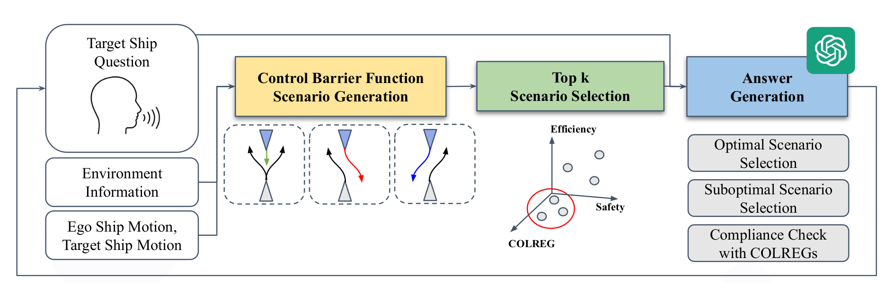

# MARQA 🚢 : LLM-Based Question Answering for Negotiation-Capable Autonomous Ship Navigation in Mixed Maritime Traffic
[](https://yeongha-shin.github.io/MARQA/)

## 🔍 Framework Overview


**MARQA**: This study develops MARQA (Maritime Autonomous Reasoning for Question Answering), an algorithm utilizing large language models (LLMs) to enable navigational question-and-answer interactions between vessels.

## 🌟 Highlights
- **`2026-10-03`** Our paper has been submitted to the Ocean Engineering Journal
  
## 📩 Getting Started

## 🎯 MARQA-Benchmark
We propose `MARQA-Benchmark', the first benchmark for question-and-answer algorithms used in ship navigation. It includes over 8,000 human-validated question-and-answer pairs based on COLREG encounter situations. We made diverse combinations for the five types of COLREG encounter situations. Dataset will be generated for encounters involving a single ship as well as situations where two ships meet.

## 📝 Citation
```
@article{Shin2026MARQA,
  title={MARQA: LLM-Based Question Answering for Negotiation-Capable Autonomous Ship Navigation in Mixed Maritime Traffic},
  author={Shin, Yeongha and Lee, Changyu and Kim, Jinwhan},
  journal={}, 
  year={2025},
}
```

## ✅ License
